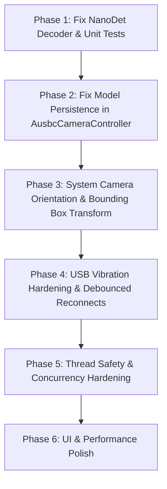

# Comprehensive Code Review & Action Plan

**Date**: October 27, 2026  
**Scope**: Review of recent uncommitted changes and new components (Detection models, Lane detection, Audio alerts, DVR stall recovery, System camera orientation, USB vibration & reconnect stability).

---

## Executive Summary

Recent changes introduce several major features:
1. **Multi-Model Detection Suite**: Bundling **YOLO26n @256**, **NanoDet-Plus-m @320**, and **YOLOv10n** with Vulkan NCNN acceleration.
2. **Classical CV Lane Detection**: Zero-model Sobel-X + percentile thresholding + sliding window quadratic lane fitting on a downsampled luma plane.
3. **Non-Interrupting Audio Alerts**: Replacing `ToneGenerator(STREAM_ALARM)` with `SoundPool` configured with navigation guidance audio attributes so it mixes with navigation/music without pausing them.
4. **DVR Watchdog & Self-Repair**: Detecting frozen VSFILE / USB frames and triggering reconnects.

However, our deep review identified **4 critical bugs/failure modes** and several concurrency/UI edge cases that must be addressed before deployment.

---

## 1. Critical Bugs & Major Failures

### 🚨 1.1 Inverted Channel Layout in NanoDetHead (Complete Detection Failure)
* **Files**: [`NanoDetHead.kt`](app/src/main/java/com/driving/hud/usbcamera/detect/NanoDetHead.kt) & [`HudUnitTests.kt`](app/src/test/java/com/driving/hud/usbcamera/HudUnitTests.kt)
* **Problem**:
  In `NanoDetHead.kt`, the decoder assumes regression distribution bins come first (indices `0..31`) and class probabilities come second (indices `32..111`):
  ```kotlin
  val s = at(anchor, 4 * BINS + c) // Line 90: reading class at offset 32 + c
  val base = group * BINS          // Line 132: reading regression at offset 0..31
  ```
  **In reality**, NanoDet-Plus (both official ONNX and `nanodet_320.ncnn.param`, lines 201–215) concatenates **80 class probabilities FIRST**, followed by **32 regression distribution bins SECOND**:
  ```text
  cat_30 2 1 239 238 240 -> 239 (80 classes) + 238 (32 regression bins)
  ```
  Even the comment in `export_detection_models.sh` line 35 states:
  `# Output must be (1, 2125, 112): 80 sigmoid class scores, then 4 sides x 8 distribution bins.`
* **Why Unit Tests Passed**:
  In `HudUnitTests.kt`, `nanoDetRow()` was synthetic and mirrored the inverted code (`row[32 + cls] = score; row[side * 8 + bins[side]] = 12f`), despite its own docstring stating the opposite.
* **Impact**:
  When running the actual `nanodet-plus-m-320.onnx` or `nanodet_320.ncnn`, NanoDet interprets class scores as box coordinates and box coordinates as class scores. It fails completely to detect vehicles or emits phantom boxes.

---

### 🚨 1.2 Selected Model Preference Overwrite in AusbcCameraController
* **Files**: [`AusbcCameraController.kt`](app/src/main/java/com/driving/hud/usbcamera/camera/AusbcCameraController.kt)
* **Problem**:
  ```kotlin
  if (OnnxDetector.activeAsset.isNotEmpty() && HudPrefs.modelAsset(ctx) != OnnxDetector.activeAsset) {
      HudLogger.i(TAG, "model preference '$asset' -> '${OnnxDetector.activeAsset}'")
      HudPrefs.setModelAsset(ctx, OnnxDetector.activeAsset)
  }
  ```
  `OnnxDetector.activeAsset` is a static field on `OnnxDetector` populated *only* when ONNX Runtime builds a session.
  When a user picks `yolo26n-256.onnx` or `nanodet-plus-m-320.onnx` in Settings and connects a camera, `DetectorFactory` selects the **NCNN** engine. `OnnxDetector` is never invoked, leaving `OnnxDetector.activeAsset` holding the previous model (e.g. `yolov10n-224.onnx`).
* **Impact**:
  Line 1084 immediately overwrites the user's newly selected model preference in `HudPrefs` back to `yolov10n-224.onnx`! It also caches the benchmark winner under the wrong model asset key.

---

### 🚨 1.3 Phone Camera Bounding Box Misalignment (Orientation Mismatch)
* **Files**: [`SystemCameraController.kt`](app/src/main/java/com/driving/hud/usbcamera/camera/SystemCameraController.kt), [`MainActivity.kt`](app/src/main/java/com/driving/hud/usbcamera/MainActivity.kt)
* **Problem**:
  - The physical camera sensor on Android phones is mounted at a fixed angle (typically **$90^\circ$** for rear camera, **$270^\circ$** for front camera relative to natural portrait).
  - While Android's hardware composer automatically rotates the preview displayed on `SurfaceView` based on device rotation (`display.rotation`), **`ImageReader` always receives unrotated sensor buffers**.
  - In `SystemCameraController.kt`, there is zero code querying `CameraCharacteristics.SENSOR_ORIENTATION` or `display.rotation`.
* **Impact by Device Orientation**:
  1. **Portrait**: Preview is portrait, but `ImageReader` is sideways landscape. The neural network detects cars sideways. Bounding boxes are rotated $90^\circ$ relative to the preview.
  2. **Reverse Landscape** ($270^\circ$ display rotation, common when phone is charging): Sensor frame is upside down relative to display ($180^\circ$ flipped). Boxes appear upside down and inverted (left $\leftrightarrow$ right, top $\leftrightarrow$ bottom).
  3. **Front Camera**: Sensor orientation is $270^\circ$ and preview is mirrored, while `ImageReader` is unmirrored. Boxes are both rotated and horizontally flipped.
  4. **Cascading Failures**:
     - `DETECTION_ZONE_TOP` (filter bottom two-thirds) cuts off the left or right side of the road in portrait.
     - Pinhole and Ground Plane distance estimation in `VehicleTracker.kt` uses `box.bottom` (the tire contact point). With rotated boxes, `bottom` corresponds to the vehicle's side or roof, causing wildly inaccurate or `NaN` distances.

---

### 🚨 1.4 USB Vibration & Cable Jitter Reconnect Failures
* **Files**: [`AusbcCameraController.kt`](app/src/main/java/com/driving/hud/usbcamera/camera/AusbcCameraController.kt), [`DvrUsbCameraController.kt`](app/src/main/java/com/driving/hud/usbcamera/camera/DvrUsbCameraController.kt)
* **The Problem (What Happens When the Car Hits a Bump)**:
  When a car hits bumps or vibrations occur, the USB-C/OTG connector experiences physical contact bounce (micro-disconnect of power or data pins for 10–100ms).
  1. **Race Condition in `openCamera` (`openInFlight || camera != null`)**:
     - When contact breaks, `onDisconnect` triggers `closeCamera()`, which initiates native teardown (`cam.close()`, `cam.destroy()`).
     - If contact is restored 20ms later, `onAttach` fires and calls `scanAndConnect()` $\rightarrow$ `openCamera(device, ctrlBlock)`.
     - Because `closeCamera()` has not finished yet, `openInFlight == true` or `camera != null`!
     - `openCamera` hits line 808:
       ```kotlin
       if (openInFlight || camera != null) {
           HudLogger.i(TAG, "openCamera: already open/in-flight")
           return
       }
       ```
       **It silently returns, leaks `ctrlBlock`, and drops the reconnect attempt entirely!**
     - When `closeCamera()` finishes milliseconds later, `camera` becomes `null`, but **no further reconnect is ever scheduled**. The camera remains dead.
  2. **Device Node Enumeration Lag (`openDevice returned null`)**:
     - Immediately calling `m.openDevice(dev)` upon receiving `onAttach` often fails because Linux `usbfs` has not finished destroying the previous file descriptor and creating the new `/dev/bus/usb/001/xxx` node.
     - `scanAndConnect` logs `"Cannot open USB device (openDevice returned null)"`, calls `listener.onError()`, and gives up completely with zero retry backoff.
  3. **Missing Stream-Stall Watchdog**:
     - In `AusbcCameraController.kt`, `startWatchdog()` is a **no-op** (`line 303: no-op: engine handles detach`).
     - `armStreamWatchdog()` only checks if `totalFrames.get() > 0` during the first 2.5 seconds after launch.
     - If vibration corrupts USB transfer packets without a full hardware detach, `UVCCamera` native isochronous stream stops delivering frames (`framesInWindow` drops to 0, logged as `fps=0`). The app has no runtime stall detector, so the display freezes forever on the last frame while driving.
  4. **Rapid Disconnect Exhaustion in DVR Mode**:
     - In `DvrUsbCameraController.kt`, each transfer failure increments `failedRecoveries`. After only **3** transient glitches (`MAX_FAILED_RECOVERIES = 3`), `giveUpOrRetry` permanently terminates the reader (`running = false; isOpen = false`) and requires the driver to manually tap "Connect" on screen.

---

## 2. Secondary Issues & Architectural Risks

### ⚠️ 2.1 Conflated Mirror Mode Semantics (Windshield HUD vs Camera Frame Inversion)
* **Files**: [`MainActivity.kt`](app/src/main/java/com/driving/hud/usbcamera/MainActivity.kt), [`MjpegFrameSink.kt`](app/src/main/java/com/driving/hud/usbcamera/camera/MjpegFrameSink.kt), [`CameraCoordinator.kt`](app/src/main/java/com/driving/hud/usbcamera/camera/CameraCoordinator.kt)
* **Problem**:
  Two completely different concepts are mapped to the same "Mirror" switch:
  1. **Windshield HUD Reflection Mode**: Inverting the phone display horizontally so it reflects legibly on the windshield glass (requires flipping all text, telemetry, and alerts).
  2. **Camera Inversion**: Correcting a physical camera lens that is mounted backwards (e.g. U2 DVR).
* **Impact**:
  In DVR and WiFi modes, `mirrorsInFrames()` is `true`, so `MainActivity` skips `scaleX = -1f` on both `cameraSurfaceView` and `hudOverlayView`. If a driver places the phone on the dashboard reflecting into the windshield with a DVR/WiFi camera, **all HUD text (speed, telemetry, LANE DEPARTURE, collision warning) remains un-mirrored and will reflect backwards (unreadable)** in the windshield glass.
  Additionally, USB and System cameras record unmirrored video while DVR/WiFi record mirrored video, creating inconsistent recording output.

---

### ⚠️ 2.2 Thread Safety & Concurrency in DvrUsbCameraController
* **Files**: [`DvrUsbCameraController.kt`](app/src/main/java/com/driving/hud/usbcamera/camera/DvrUsbCameraController.kt)
* **Problem**:
  - `open()` and `stopReader()` are called from both the UI thread (user tapping Connect) and the background preview thread (`previewLoop` stall recovery: `open(forcePermission = false)`).
  - Neither `open()` nor `stopReader()` is synchronized. If a user taps "Connect" or the USB receiver triggers while `previewLoop` is restarting, two reader threads can be spawned concurrently.
  - In `stopReader()`, if `previous.isAlive` is true and `connection == null` (preview reader), it returns `true` without setting `thread = null`.
  - `streamLoop` calls `requestPermissionIfMissing()` from the background thread, registering `permissionReceiver` without synchronization against `close()`.

---

### ⚠️ 2.3 Thread Safety & Asynchronous Loading in AlertTone
* **Files**: [`AlertTone.kt`](app/src/main/java/com/driving/hud/usbcamera/alert/AlertTone.kt)
* **Problem**:
  - `pool`, `beepId`, and `warnId` are mutable fields without `@Volatile` or synchronization, accessed from both the main thread (`warmUp()`, `release()`) and background inference threads (`beep()`).
  - `SoundPool.load()` is asynchronous. When `beep()` catches an error and calls `release()`, subsequent calls re-invoke `ensurePool()`, but playing immediately returns `0` (fails silently) until loading completes in the background.

---

### ⚠️ 2.4 UI & Performance Inefficiencies
1. **Departure Banner Inset**:
   In `HudOverlayView.kt`, `drawLaneDeparture` computes `bottom = rect.bottom - bottomInset - 24f * uiScale`. When the video is letterboxed within the view (`rect.bottom < view.height`), subtracting `bottomInset` (the control bar height measured from the bottom of the *View*) pushes the banner up into the middle of the road.
2. **Per-Frame Canvas Allocation in MjpegFrameSink**:
   In `flipHorizontally()`, `Canvas(dst)` is allocated on every frame (15–30 Hz), causing unnecessary GC churn.
3. **Missing Model Reload on Resume**:
   In `MainActivity.kt`, returning from `SettingsActivity` calls `applySavedSettings()`, but if the camera mode did not change, `cameraManager.switchMode` is skipped and the camera is not prompted to rebuild its detector with the newly chosen model.
4. **Export Script Dependency**:
   In `tools/export_detection_models.sh`, line 26 specifies `YOLO("yolo26n.pt")`. `yolo26n.pt` is not an official Ultralytics release on PyPI, so the script cannot be run standalone without pre-existing weights.

---

## 3. Step-by-Step Remediation Plan



### Phase 1: Fix NanoDet Head Decoder & Unit Tests
1. **Update `NanoDetHead.kt`**:
   - Fix class score reading at line 90:
     ```kotlin
     val s = at(anchor, c) // Classes are at indices 0 until labels.size
     ```
   - Fix regression distribution reading at line 131:
     ```kotlin
     val base = labels.size + group * BINS // Regression starts at index labels.size (80)
     ```
   - Update docstrings and logging to reflect that class scores precede regression distribution bins.
2. **Update `HudUnitTests.kt`**:
   - Fix `nanoDetRow()`:
     ```kotlin
     if (cls >= 0) row[cls] = score
     for (side in 0 until 4) {
         row[classes + side * 8 + bins[side]] = 12f
     }
     ```
   - Run `./gradlew test` to verify that unit tests match the real model export.

---

### Phase 2: Fix Model Asset Persistence & Caching
1. **Update `AusbcCameraController.kt`**:
   - Remove reliance on `OnnxDetector.activeAsset`.
   - Key provider memory directly by `$asset@${w}x$h` and save `DetectorFactory.activeBackend`, exactly like `MjpegFrameSink.kt` and `SystemCameraController.kt`.
2. **Trigger Detector Rebuild on Model Change in `MainActivity.kt`**:
   - Track `lastModelAsset`. If the user returns from Settings with a different model, trigger a detector reload on the active camera controller without requiring a manual source toggle.

---

### Phase 3: System Camera Orientation & Bounding Box Transform
1. **Query Sensor Orientation & Display Rotation in `SystemCameraController.kt`**:
   - Read `CameraCharacteristics.SENSOR_ORIENTATION`.
   - Calculate relative rotation:
     ```kotlin
     val displayRotation = when (windowManager.defaultDisplay.rotation) {
         Surface.ROTATION_0 -> 0
         Surface.ROTATION_90 -> 90
         Surface.ROTATION_180 -> 180
         Surface.ROTATION_270 -> 270
         else -> 0
     }
     val relativeRotation = if (isFacingBack) {
         (sensorOrientation - displayRotation + 360) % 360
     } else {
         (sensorOrientation + displayRotation) % 360
     }
     ```
2. **Transform Bounding Box Coordinates in `SystemCameraController.kt`**:
   - Implement `rotateDetection(d: Detection, rotationDegrees: Int, isMirrored: Boolean): Detection`.
   - Transform normalized box coordinates before publishing through `listener.onDetections`:
     - $90^\circ$: `(1 - bottom, left, 1 - top, right)`
     - $180^\circ$: `(1 - right, 1 - bottom, 1 - left, 1 - top)`
     - $270^\circ$: `(top, 1 - right, bottom, 1 - left)`
     - Front camera horizontal flip: `(1 - right, top, 1 - left, bottom)`
3. **Swap Frame Dimensions for VideoFit in `MainActivity.kt`**:
   - When `relativeRotation` is $90^\circ$ or $270^\circ$, report `frameSize()` as `frameH to frameW` ($720 \times 1280$) so `applyVideoFit()` fits the portrait aspect correctly.

---

### Phase 4: USB Vibration Hardening & Debounced Reconnects
1. **Add Attach/Detach Debounce in `AusbcCameraController.kt`**:
   - Introduce a debounced reconnect queue:
     ```kotlin
     private var reconnectJob: ScheduledFuture<*>? = null
     private fun scheduleDebouncedReconnect(delayMs: Long = 400L) {
         reconnectJob?.cancel(false)
         reconnectJob = controlExecutor.schedule({
             scanAndConnect()
         }, delayMs, TimeUnit.MILLISECONDS)
     }
     ```
   - On `onAttach`: Instead of immediately hammering `openDevice` on an unstable USB node, schedule a debounced reconnect (300–500ms). If further attach/detach events arrive during vibration bounce, reset the timer so connection settles before opening.
2. **Handle Pending Reconnect in `closeCamera()`**:
   - If `openCamera` is called while `camera != null` or `openInFlight == true`, set `reconnectPending = true`.
   - When `closeCamera()` finishes tearing down the old native instance, check `if (reconnectPending)` and immediately trigger `scheduleDebouncedReconnect(200L)`.
3. **Add Runtime Stream-Stall Detection in `publishStats()`**:
   - In `publishStats()`:
     ```kotlin
     if (frames == 0) {
         stalledSeconds++
         if (stalledSeconds >= 3) {
             HudLogger.w(TAG, "UVC stream stalled for 3s (vibration/freeze) - triggering restart")
             stalledSeconds = 0
             closeCamera()
             scheduleDebouncedReconnect(100L)
         }
     } else {
         stalledSeconds = 0
     }
     ```
4. **Retry Loop with Exponential Backoff for `openDevice`**:
   - If `m.openDevice(dev)` returns `null` on attach due to Linux enumeration lag, retry up to 3 times with 250ms backoff before giving up.
5. **Increase DVR Stall Recovery Resilience**:
   - In `DvrUsbCameraController.kt`, reset `failedRecoveries` after successful reconnects, and allow up to 10 automated self-repairs with exponential backoff instead of giving up after only 3.

---

### Phase 5: Thread Safety & Concurrency Hardening
1. **Synchronize `DvrUsbCameraController.kt`**:
   - Guard `open()` and `stopReader()` with a synchronized lock.
   - Set `thread = null` when a terminated thread is cleaned up.
   - Post USB permission requests and receiver registrations to the main thread via a Handler.
2. **Thread-Safe `AlertTone.kt`**:
   - Synchronize `ensurePool()` and `release()`.
   - Add `SoundPool.setOnLoadCompleteListener` so `beep()` knows whether samples are decoded and ready.

---

### Phase 6: UI & Performance Polish [COMPLETED]
1. **Fix Departure Banner Inset in `HudOverlayView.kt`**:
   - Updated `drawLaneDeparture()`: calculates `maxBottom = height - bottomInset - 16f * uiScale` and `bottom = minOf(rect.bottom - 16f * uiScale, maxBottom)` so letterboxed video does not displace the banner upwards into the road.
2. **Reuse Canvas in `MjpegFrameSink.kt`**:
   - Cached `mirrorCanvas` and recycled old `mirrorScratch` when resolution changes, eliminating per-frame Canvas object allocation at 30 fps.
3. **Windshield HUD Reflection Decoupled from In-Frame Camera Flip**:
   - In `MainActivity.kt`: `binding.hudOverlayView.scaleX = -1f` is now always applied in mirror mode (except for rear phone camera) so HUD text reflects legibly in the windshield glass, while `binding.cameraSurfaceView.scaleX` is only mirrored for sources that do not already invert decoded frames.
4. **Settings Model Sync & Instant Detector Reload**:
   - In `SettingsActivity.kt`: wired `rgModel.setOnCheckedChangeListener` and text focus listeners to keep presets and custom model fields in sync.
   - Added `reloadDetector()` across `CameraCoordinator`, `AusbcCameraController`, `SystemCameraController`, `WifiCameraController`, and `DvrUsbCameraController`.
   - In `MainActivity.kt`: tracked `lastModelAsset` to trigger immediate detector reload when changing models in Settings without requiring a camera toggle.
5. **Immediate Telemetry Sync on Lane Detection Toggle**:
   - In `MainActivity.kt`: called `refreshTelemetry()` immediately when lane detection is disabled to clear stale lane offsets.
