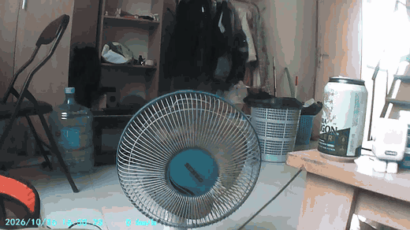

# Android Dashcam & Driving HUD

A high-performance, fault-tolerant Android application and Heads-Up Display (HUD) dashcam supporting **USB (UVC/OTG) webcams**, **built-in system cameras (rear/front)**, **WiFi IP cameras (RTSP / HTTP MJPEG)** and the **U2 DVR dashcam (USB mass-storage)** with on-device **YOLOv10n AI object detection** accelerated by **NCNN** and **ONNX Runtime**.

---

## 🎬 Demo

This clip is a real **1280×720** recording made *by the app itself* from a **U2 DVR dashcam**
(camera source = *U2 DVR*), with the detection boxes, distances and TTC burned into the frames —
`BOTTLE`, `CUP` and `DINING TABLE` detections, plus the DVR's own clock/speed OSD in the corner.
Those OSD characters are **cyan**, not magenta — that is the colour pipeline being correct
(see *True-Color Chroma Pipeline* below):



| File | What it is |
| :--- | :--- |
| [`docs/media/demo-u2-dvr-preview.gif`](docs/media/demo-u2-dvr-preview.gif) | 6 s silent preview, 520 px wide, for viewing inline (2.5 MB) |
| [`docs/media/demo-u2-dvr-720p.mp4`](docs/media/demo-u2-dvr-720p.mp4) | Full 10 s clip, H.264 in MP4 for in-browser playback |
| [`docs/media/demo-u2-dvr-720p.mkv`](docs/media/demo-u2-dvr-720p.mkv) | The unmodified file the app wrote: hardware H.264 in Matroska, exactly as it came off the device |

> **Why 720p?** Because that is what this DVR streams. The U2 DVR does not serve a 1080p live
> feed on any path the app can reach: over USB its removable 2 GB FAT volume only holds a single
> *static* preview JPEG (`VSFILE`), and in video mode it emits 1280×720 MJPEG only. The vendor app
> never even asks for another size — it issues `getResolution` (cmd `0x2F`) at connect but never
> `setResolution` (cmd `0x0F`).

---

## 🚗 Key Features

### 1. 🧠 On-Device AI Detection & Distance Estimation
- **YOLOv10n Neural Network**: Real-time object detection for vehicles (`car`, `truck`, `bus`, `motorcycle`) and pedestrians.
- **NCNN Acceleration Engine**: Highly optimized native ARM64 NEON and Vulkan compute pipeline (`libncnn.so`) yielding ultra-low inference latency (~15–25ms on modern Android chipsets).
- **Dual Inference Backends**:
  - **NCNN** (Default / High performance): `yolov10n_224.ncnn` (224×224) and `yolov10n_320.ncnn` (320×320).
  - **ONNX Runtime**: `yolov10n-224.onnx`, `yolov10n-320.onnx`, and pruned variants.
- **Fused Ground-Plane & Pinhole Distance Estimation**: Fuses ground-plane camera pitch geometry ($Z_g = \frac{h_c}{\tan(\theta_{pitch} + \alpha_y)}$) with real-world 3D object size priors ($Z_p = \frac{f_y \cdot H_{real}}{h_{px}}$) to calculate accurate distances and Time-To-Collision (TTC).
- **Interactive Calibration Wizard**: On-screen horizon line calibration, camera mounting height ($h_c$), vertical FOV adjustment, and automatic vanishing-point pitch solver.

### 2. 📹 Multi-Source Camera Support
- **USB / UVC OTG Cameras**: Direct low-latency native streaming from USB video class cameras with packet-drop recovery and cable vibration tolerance.
- **Built-in System Cameras**: High-resolution Camera2 pipeline utilizing Android's built-in rear camera with instant one-tap flip to the front camera.
- **WiFi / IP Network Cameras**:
  - **RTSP Streams** (`rtsp://...`) via hardware-accelerated MediaPlayer.
  - **HTTP MJPEG Streams** (`http://...`) with pooled memory buffers and live canvas rendering.
- **U2 DVR Dashcams** (`VID 0x1902 / PID 0x3241`, "Buildwin Media-Player"): these are **not** UVC
  cameras — they enumerate as USB mass storage. The app claims the interface and pulls the live
  720p MJPEG stream directly over SCSI Bulk-Only Transport (`DvrBot`), so no vendor app is needed.
  Close `com.fvision.camera` if it is running: it grabs the same interface.
- **Quick Camera Switching**: Cycle between USB, System, WiFi and DVR cameras directly from the HUD bottom toolbar or customize via Settings.

### 3. 💾 Smart Dashcam Recording & Overlay Burn-In
- **Hardware Matroska (MKV) Recording**: Hardware H.264 MediaCodec encoding directly into `.mkv` files.
- **Automatic Storage Resolution**:
  - Prefers physical, removable **MicroSD cards** (`[SD_CARD]/Android/data/com.driving.hud.usbcamera/files/Movies`) so phone storage is never filled.
  - If no SD card is detected, saves internally and automatically exports to the public **MediaStore (`Movies/HUD`)** in the background so recordings appear immediately in Gallery and Google Photos.
- **Zero-Copy NV21 Overlay Burn-In**: Renders tactical HUD bounding boxes, vehicle classifications, distances (meters), and TTC warning badges directly onto the recorded video frames.
- **True-Color Chroma Pipeline**: Direct hardware-aligned chroma mapping prevents red/blue color channel inversion across USB, built-in, and WiFi cameras, with an optional UV-swap toggle in Settings for non-standard OEM encoders.
- **Synchronized Subtitles (.SRT)**: Generates a matching `.srt` subtitle file alongside every recording, providing frame-by-frame telemetry and detection logs in standard media players (VLC, MX Player, etc.).

### 4. 🚘 Driving HUD Display
- **Windshield Mirror Mode**: 1-tap horizontal flip so the screen reflects legibly when placed on a dashboard reflecting onto the windshield.
- **Picture-in-Picture (PiP) & Split Screen**: Run navigation apps (Google Maps, Waze) in split-screen or float the HUD as a PiP window while keeping detection and collision alerts active.
- **Live Battery & Thermal Telemetry**: Real-time battery drain rate (%/hr), temperature, and FPS monitoring with 5-second EMA low-pass filtering.

---

## 🔌 Cameras & Devices We Tested

Every path below was driven end-to-end on real hardware (live preview + detection + recording), not
just compiled against. "Verified" means we saw frames on screen and in a recorded file.

| Camera / device | How it attaches | What the hardware actually does | Result |
| :--- | :--- | :--- | :--- |
| **U2 DVR dashcam** — `VID 0x1902 / PID 0x3241`, product string `GENERAL - AUDIO`, `INQUIRY` → `BuildwinMedia-Player 1.00` | USB **mass storage**, *not* UVC: 1 interface, class 8 / sub 6 / proto `0x50` (Bulk-Only), endpoints `0x01` OUT + `0x81` IN, 512 B | Idle it is a 2 GB FAT volume (2,147,614,720 B, label `Buildwin`) holding `VSFILE`, `HWC` and the vendor's own `DVR.apk`. Once a host claims the interface the FAT disappears and the LUN becomes a **ring of 512 KB video slots** (8704-byte header + one JPEG at offset 8704, slot magic `00 08 00 00`); the ring advances continuously. ~850 KB/s over Bulk-Only ⇒ **1280×720 MJPEG at 14–17 fps** | ✅ **Working** — *U2 DVR* source (`DvrBot` + `DvrUsbCameraController`) |
| **`icspring camera`** — `VID 0x32E6 / PID 0x9211` | USB **UVC + UAC composite** (webcam with mic), isochronous video endpoints | Advertises MJPEG `bFormatIndex=1` with 8 frame sizes (`fmt=2` raw, 8 more). `VS_COMMIT_CONTROL` **STALLs** for every format/frame/interval tried — and the camera streams anyway as soon as the streaming interface is claimed at alt 3. Host URB must be **8 × 2048 B**: Android reports the high-bandwidth total (3072) which the kernel rejects with `EMSGSIZE` | ✅ **Working** — *USB / UVC* source (libusb) |
| **Tablet built-in camera** (rear + front) | Camera2 / CSI | Preview and `YUV_420_888` analysis expose *different* size lists; a session only configures on the **intersection** (e.g. preview offers 1920×1080 while analysis stops at 1280×720). Superseded sessions still deliver `onConfigured`, so callbacks are generation-checked | ✅ **Working** — *System* source |
| **WiFi / IP camera** | RTSP or HTTP | RTSP via `MediaPlayer`; HTTP **MJPEG** streams fed through the same JPEG sink as the DVR | ✅ **Working** — *WiFi* source |
| **Host: Lenovo TB331FC** tablet, Android 13 (SDK 33), arm64-v8a, 7,000 mAh | — | The device every result above was verified on (PiP, recording, detection all live here) | ✅ |
| **Host: itel P663LN** phone, Android 13 (SDK 33), Unisoc/Transsion | — | **Unsupported host**: no `video/mjpeg` MediaCodec at all (`NAME_NOT_FOUND`), `openDevice` returns null intermittently, and isochronous host transfers never delivered a single byte. The same UVC camera works on the Lenovo | ⚠️ Documented limitation |

**Operational notes learned the hard way**
- The U2 DVR's own app (`com.fvision.camera`) force-claims the interface and detaches `usb-storage`
  (the volume vanishes and the device flaps every ~23 s). Disable it before using DVR mode:
  `adb shell pm disable-user --user 0 com.fvision.camera`.
- The DVR's volume UUID changes on every insert, and `/storage/<uuid>` is not readable from `adb`
  (media_rw group, `fmask=0007`).
- Android 13 refuses to show the USB permission dialog for a **UVC** device unless the app already
  holds the `CAMERA` runtime permission.
- Android 13 large-screen launchers ship their *own* USB camera app (`com.shenyaocn.android.usbcamera`)
  that holds the camera and makes `openDevice` return null — `pm disable-user` it too.

---

## �🔋 Real-World Battery & Power Benchmarks

Field tested on a device with a **7,000 mAh** battery running **YOLOv10n AI object detection**, active camera streaming, and a **navigation app running concurrently in Picture-in-Picture (PiP)**:

| Metric | Measured Real-World Value |
| :--- | :--- |
| **Average Power Draw** | **2.7 W – 3.0 W** (~700–780 mA @ 3.85V) |
| **Peak Surge Power** | **~4.0 W** (during complex multi-object inference passes) |
| **Measured Drain Rate** | **~1% every 6 minutes** (approx. **10.0% / hour**) |
| **Total Continuous Runtime** | **~10 hours** of driving on a full 7,000 mAh charge |
| **Multitasking Stability** | Full background tracking & alerts sustained while Google Maps/Waze navigates in PiP |

> **Note on Telemetry Smoothing**: The HUD applies a 5-second Exponential Moving Average (EMA, $\alpha = 0.2$) filter to instantaneous current and wattage, ensuring that transient 4W inference spikes do not cause fluctuating battery runtime estimates.

## 📁 Repository Structure

```
android-dashcam/
├── .github/workflows/
│   └── build-and-release.yml              # Automated GitHub Actions CI/CD & release pipeline
├── app/
│   ├── build.gradle.kts                   # NDK r28c, CMake, NCNN & ONNX build script
│   └── src/main/
│       ├── AndroidManifest.xml            # Permissions (USB, Camera, Network, Storage)
│       ├── assets/                        # YOLOv10n NCNN (.param/.bin) & ONNX models
│       │   ├── yolov10n_224.ncnn.param
│       │   ├── yolov10n_224.ncnn.bin
│       │   ├── yolov10n_320.ncnn.param
│       │   ├── yolov10n_320.ncnn.bin
│       │   └── yolov10n-224.onnx
│       ├── cpp/                           # Native NCNN detector & UVC engine
│       │   ├── CMakeLists.txt
│       │   ├── ncnn_detector.cpp
│       │   └── native-camera-jni.cpp
│       ├── java/com/driving/hud/usbcamera/
│       │   ├── MainActivity.kt            # HUD UI, telemetry, dialogs & lifecycle
│       │   ├── SettingsActivity.kt        # Camera, model, confidence & resolution preferences
│       │   ├── camera/                    # Unified multi-camera coordinator
│       │   │   ├── CameraCoordinator.kt   # USB / System / WiFi / DVR switching
│       │   │   ├── AusbcCameraController.kt
│       │   │   ├── SystemCameraController.kt
│       │   │   ├── WifiCameraController.kt
│       │   │   ├── MjpegFrameSink.kt      # Shared JPEG → NV21 → detect/record pipeline
│       │   │   ├── DvrUsbCameraController.kt # U2 DVR as a live camera source
│       │   │   ├── DvrBot.kt              # SCSI Bulk-Only Transport (CBW/CSW)
│       │   │   ├── DvrFrameParser.kt      # DVR video-slot / JPEG frame parsing
│       │   │   ├── DvrVolume.kt           # DVR volume discovery + diagnostics
│       │   │   └── DvrUsbProbe.kt         # Opt-in USB/BOT/header probe
│       │   ├── detect/                    # YOLOv10n inference engines
│       │   │   ├── NcnnDetector.kt        # JNI NCNN high-speed inference
│       │   │   ├── OnnxDetector.kt        # ONNX Runtime fallback
│       │   │   └── DetectorFactory.kt
│       │   ├── record/                    # Video recording & overlay
│       │   │   ├── MkvRecorder.kt         # H.264 MediaCodec + Matroska muxer
│       │   │   ├── Nv21OverlayRenderer.kt # Zero-copy bounding box burn-in
│       │   │   ├── SrtWriter.kt           # Subtitle generator
│       │   │   └── RecordingStorageManager.kt # SD card & MediaStore export
│       │   ├── alert/                     # Collision warning & TTC tracker
│       │   └── ui/                        # HUD overlay, distance ladder & widgets
│       └── jniLibs/arm64-v8a/             # Prebuilt libncnn.so & libusb1.0.so
├── docs/media/                            # Demo clips verified on hardware (see 🎬 Demo)
│   ├── demo-u2-dvr-720p.mkv               # Recording exactly as the app wrote it
│   ├── demo-u2-dvr-720p.mp4               # Same bitstream, remuxed for browser playback
│   └── demo-u2-dvr-preview.gif            # Inline preview
└── tools/
    ├── debug_tablet.sh                    # One-command on-device debug session + verdict
    ├── adb_wifi.sh                        # adb-over-WiFi setup
    ├── export_yolo_224.py                 # PyTorch YOLO export script
    ├── plt_symbols.py                     # ELF PLT stub → imported symbol map
    └── annotate_disasm.py                 # Rewrite disassembly with real symbol names
```

---

## 🛠️ Building & Developing

### Local Build (macOS / Linux / Windows)
1. Open the project in **Android Studio** (Koala / Ladybug or newer).
2. Ensure Android NDK `28.2.13676358` (r28c) and CMake are installed via SDK Manager.
3. Build the debug or release APK:
   ```bash
   ./gradlew testDebugUnitTest
   ./gradlew assembleRelease
   ```
   The resulting signed release APK is generated at:
   `app/build/outputs/apk/release/app-release.apk`

4. Install directly to a connected device:
   ```bash
   adb install -r app/build/outputs/apk/release/app-release.apk
   ```

### 🚀 CI/CD & Automated GitHub Releases
This repository includes a fully automated GitHub Actions workflow (`.github/workflows/build-and-release.yml`):
- **On every push / PR to `main`**: Runs unit tests and builds both Debug and Release APKs as workflow artifacts.
- **On git tag creation (`v*`)**: Automatically compiles the project, runs tests, and publishes a new **GitHub Release** with `app-release.apk` and `app-debug.apk` attached.
- **Manual Trigger**: Can be run on demand from the **Actions** tab with an optional release publish toggle.

To create a release:
```bash
git tag v1.0.0
git push origin v1.0.0
```
GitHub Actions will automatically build, package, and publish the release.

---

## 🎯 Usage & Calibration

1. **Connect Camera**:
   - **USB Camera**: Plug in via OTG adapter and tap **Connect / Request Permission**.
   - **System Camera**: Tap the camera source icon on the bottom toolbar or open Settings to select the phone's built-in camera (rear or front).
   - **WiFi Camera**: Open Settings, select **WiFi / IP Camera**, and enter your RTSP (`rtsp://192.168.1.x:554/...`) or HTTP MJPEG URL.
2. **Horizon & Distance Calibration**:
   - Tap **Calibration** on the bottom toolbar.
   - Adjust the **Pitch Angle** slider until the cyan horizon line aligns with the physical road horizon.
   - Enter your phone's mounting height from the road surface (e.g., 1.25m).
   - Tap **Save & Apply**.
3. **Dashcam Recording**:
   - Tap **REC** to start recording with detection overlays burned into the video.
   - When finished, tap **STOP** to view file details, play immediately in your video player, or share.
